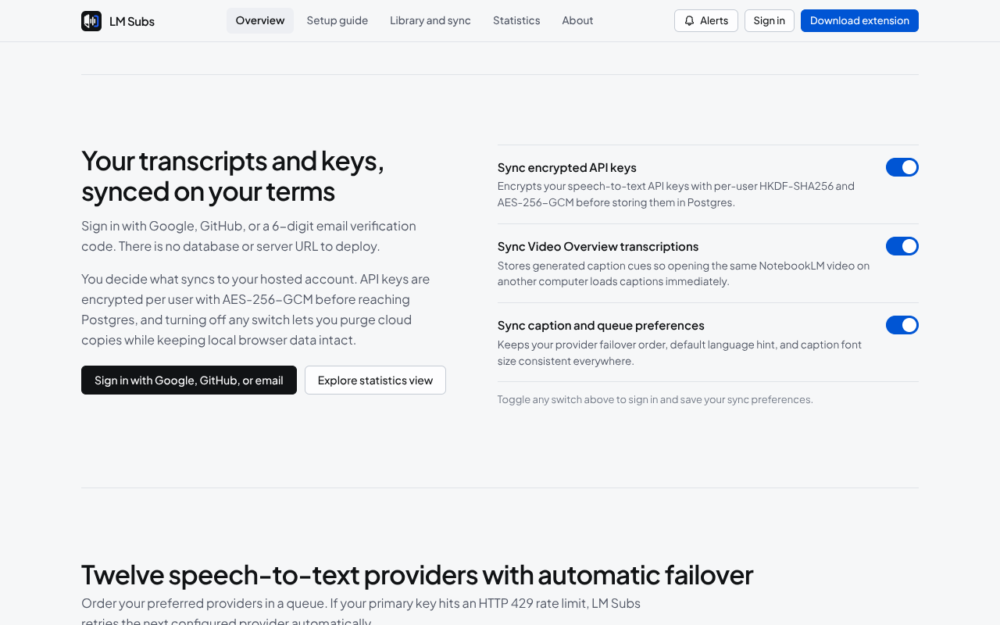
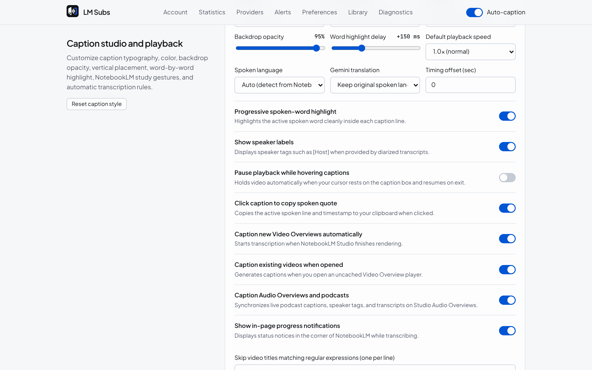

<div align="center">


# LM Subs

**Synchronized closed captions, SRT/WebVTT/TXT/JSON export, and opt-in encrypted cloud sync for Google NotebookLM Video Overviews.**

[](#security-and-privacy-architecture)
[](#how-lm-subs-delivers-captions-in-seconds)
[](#supported-speech-to-text-providers)
[](#hosted-account-and-opt-in-cloud-sync)
[](#hosted-account-and-opt-in-cloud-sync)
[](#development-and-testing)
[](LICENSE)

[**Download `lm-subs-v0.2.1.zip`**](docs/releases/lm-subs-v0.2.1.zip) | [**Beginner Setup Guide**](#install-guide-no-coding-or-credit-card-needed) | [**Neon vs Supabase & Firebase Guide (`DEPLOYMENT_GUIDE.md`)**](DEPLOYMENT_GUIDE.md) | [**About (`@sarang-cmd`)**](#about-the-creator)

<br />


</div>

---

## Install guide (no coding or credit card needed)

You do not need terminal commands, developer tools, or a paid subscription to use LM Subs. Follow these four steps in **Google Chrome**, **Brave**, **Microsoft Edge**, or **Arc**:

### Step 1: Download and unzip the extension folder
1. Download [**`lm-subs-v0.2.1.zip`**](docs/releases/lm-subs-v0.2.1.zip) to your computer.
2. **Unzip** it into a normal folder:
   * **macOS:** Open **Downloads** in Finder and double-click `lm-subs-v0.2.1.zip`. Move the unzipped folder into **Documents** so it stays in a permanent spot.
   * **Windows:** Open **Downloads** in File Explorer, right-click `lm-subs-v0.2.1.zip`, click **Extract All...**, and click **Extract**. Keep the unzipped folder somewhere permanent such as **Documents**.

### Step 2: Load the folder in Chrome
1. Open a new browser tab, type `chrome://extensions` into the address bar, and press **Enter** (`brave://extensions` in Brave, `edge://extensions` in Edge).
2. Turn **ON** the **Developer mode** switch in the top-right corner of the page.
3. Click the **Load unpacked** button in the top-left corner and select the unzipped `lm-subs` folder from Step 1.
4. Click the puzzle-piece icon in the top-right Chrome toolbar and click the pin icon beside **LM Subs**.

### Step 3: Paste one free Groq transcription key (60 seconds)
LM Subs connects directly from your browser to a speech-to-text provider so nobody charges you a subscription fee. **Groq** offers a free developer account with no credit card that transcribes up to 8 hours of audio per day:
1. Open [console.groq.com/keys](https://console.groq.com/keys) and sign in with Google or GitHub.
2. Click **Create API Key**, enter `LM Subs` as the name, and copy the key starting with `gsk_`.
3. Click the **LM Subs** icon in your Chrome toolbar, paste that `gsk_...` code into the **API key** box, and click **Save**.

### Step 4: Watch any NotebookLM Video Overview
1. Open [notebooklm.google.com](https://notebooklm.google.com), open any notebook, and play a **Video Overview**.
2. Within about three seconds, synchronized captions appear at the bottom of the player.
3. Hover near the top-right corner of the video to toggle **CC**, adjust font size (**A-** / **A+**), shift timing (`-0.25s` / `+0.25s`), or export **`.srt`**, **`.vtt`**, **`.txt`**, or **`.json`** files.

---

## Product tour and screenshots

### In-player closed captions and export bar inside NotebookLM
Synchronized two-line closed captions (`CC`, `A-`/`A+`, timing offset, `.srt`/`.vtt`/`.txt`/`.json` download, clipboard `Copy`, subtitle `Import`, and `Regen`) rendered inside an isolated Shadow DOM container across inline Studio playback, modal dialogs, Fullscreen, and OS Picture-in-Picture.

<p align="center">
  
</p>

### Audio-only stream extraction, 12-provider failover, and opt-in sync
Extracts NotebookLM's ~3.4 MB `=m140` audio stream instead of uploading 50+ MB MP4 video files, advances automatically across your configured provider queue on `HTTP 429` rate limits, and syncs only the categories you enable.

<p align="center">
  
</p>

### Chrome toolbar popup
Configure a free Groq or Mistral key, inspect account sync state, trigger captions on the active NotebookLM tab, or export `.srt`, `.vtt`, `.txt`, and `.json` files in two clicks. Includes an inline first-time setup guide when no key is saved yet.

<p align="center">
  
</p>

### Settings, opt-in privacy switches, statistics, and priority queue
Sign in with Google, GitHub, or a 6-digit email code, toggle granular cloud sync switches (`Sync API keys`, `Sync transcriptions`, `Sync preferences`), inspect real transcription metrics, and order all 12 speech-to-text providers.

<p align="center">
  
</p>

---

## Why LM Subs?

Google NotebookLM generates narrated **Studio Video Overviews**, yet its built-in player ships without closed captions, downloadable subtitle files, or cross-browser transcript sync.

Naive transcription tools upload entire 50 to 120 MB HD `.mp4` video files or inflate compressed audio into 40+ MB of uncompressed `.wav` data, hitting API upload limits and turning a 3-minute Video Overview into a multi-minute wait.

| Metric | Full Video / WAV Upload | LM Subs (`v0.2.1`) |
| :--- | :--- | :--- |
| **Media payload** | 50 to 120 MB `.mp4` + 42 MB `.wav` | **~3.4 MB `=m140` AAC** (or HTTP `206` audio byte ranges) |
| **Audio prep overhead** | 45 to 90s full download + decode | **0 ms** direct `=m140` passthrough (`<1.2s` Range remux) |
| **Whisper timestamp mode** | Slow word-level DTW alignment | **Segment timestamps (~200x real-time)** + clause balancer |
| **Long-video chunking** | Sequential 1-by-1 upload | **3x concurrent workers + live progressive cues** |
| **Second-browser open** | Re-downloads and re-transcribes | **~50 ms Neon Postgres cache hit** (`0` media bytes fetched) |

---

## How LM Subs delivers captions in seconds

1. **Zero-decode `=m140` audio stream passthrough (`0 ms` IPC):** Google's FIFE `=m140` stream serves a ~3 to 6 MB `audio/mp4` payload. `service-worker.js` inspects `inspectMp4Tracks()` and `Content-Type` and forwards pure-audio payloads (`<=24 MB`) directly to your speech-to-text provider without inflating them into PCM `.wav`.
2. **Parallel `HTTP 206 Partial Content` audio byte-range extraction:** When a CDN edge serves a muxed 50 to 120 MB `=m22` `video/mp4`, LM Subs aborts the full download after reading headers, probes the `moov` atom via `Range: bytes=...`, and fetches only the 3 to 6 MB `soun` audio slices over 6 parallel `HTTP 206` requests.
3. **Segment-level Whisper timestamps (~200x real-time):** Requesting segment timestamps instead of word-level DTW alignment and balancing two-line cues client-side via `cuesFromSegments()` cuts transcription latency by 4 to 8x.
4. **Concurrent chunk workers + progressive cues (`SUBTITLES_PARTIAL`):** Long recordings (`>24 MB`) transcribe 3 audio chunks concurrently and render live cues on the `<video>` element as soon as chunk 1 completes.
5. **Pre-download Neon Postgres cache hit (~50 ms):** Before downloading media from Google's CDN, `service-worker.js` checks local storage and `GET /api/sync/subtitle?cacheKey=...` so previously captioned videos load instantaneously across your signed-in browsers.

---

## System architecture

<p align="center">
  
</p>

* **Page Main World (`src/content/page-hook.js` at `document_start`):** Observes NotebookLM SSR `AF_initDataCallback` payloads and `batchexecute` RPCs (`R7cb6c`, `gArtLc`) without touching storage or credentials.
* **Isolated Content Script (`src/content/content.js` + `player-overlay.js`):** Attaches both a native `<track kind="subtitles">` (for OS Picture-in-Picture) and an isolated closed ShadowRoot caption bar inside NotebookLM's `<video>` container.
* **MV3 Service Worker (`src/background/service-worker.js`):** Sole reader of `secretApiKeys` and `cloudSyncSecret` in `chrome.storage.local`. Executes audio stream extraction, 12-provider failover, and opt-in cloud sync.
* **Hosted Web App & Neon Postgres API (`src/web/`, `server/`, `api/index.js`):** React + Radix UI web application (`/`, `/guide`, `/library`, `/stats`, `/about`) and Hono REST API backed by Neon Serverless PostgreSQL (`db/schema.sql`). Includes Vercel Web Analytics and Vercel Speed Insights.

---

## Hosted account and opt-in cloud sync

End users never self-host a database or configure a server URL. Sign in from the extension or web app using **Google**, **GitHub**, or a **passwordless 6-digit email code**:

* **Granular opt-in switches:** Control three independent switches in both the web library and extension settings:
  1. **Sync API keys** (`AES-256-GCM` per-user HKDF-derived encryption bound to `${userId}:${providerId}` as AAD).
  2. **Sync transcriptions** (searchable caption archive with `.srt`, `.vtt`, `.txt`, and `.json` downloads).
  3. **Sync preferences** (provider priority order, caption font scale, and target language).
* **One-click cloud purge:** Turning off any switch can immediately delete your stored cloud rows for that category in Neon Postgres while keeping your local Chrome data untouched.
* **Live SQL statistics (`/stats`):** Displays real `COUNT`, `SUM`, `AVG`, 14-day daily transcription volume, upload bandwidth saved, and per-provider latency queried directly from `lmsubs_subtitles` and `lmsubs_transcription_events`.

### Deploying your own fork (Neon correlated with Supabase & Firebase)

Read [**`DEPLOYMENT_GUIDE.md`**](DEPLOYMENT_GUIDE.md) for:
* A first-principles guide correlating **Neon** with **Supabase** and **Firebase** (SQL Editor migrations, why no storage buckets are needed, why Firebase auto-configures Google OAuth while Supabase and Vercel + Neon use Google Cloud Console OAuth credentials, and server-vault encryption vs client RLS).
* Exact step-by-step instructions to connect Neon (`falling-cherry-16443194`), Google OAuth, GitHub OAuth, and Resend on Vercel.

---

## Supported speech-to-text providers

Configure one key or stack multiple providers in priority order for automatic `HTTP 429` rate-limit failover:

| Rank | Provider | Default model | Free tier and billing notes |
| :-: | :--- | :--- | :--- |
| **1** | **Groq** *(Recommended)* | `whisper-large-v3-turbo` | Free developer tier (~8 hrs/day, no credit card) |
| **2** | **Mistral AI** *(Recommended)* | `voxtral-mini-latest` | Free La Plateforme tier, 48 MB file cap |
| **3** | **Google Gemini** | `gemini-2.5-flash` | Free Google AI Studio tier, native translation |
| **4** | **Deepgram** | `nova-3` | $200 free starter credit |
| **5** | **AssemblyAI** | `universal` | $50 free starter credit |
| **6** | **Gladia** | `solaria-1` | 10 free hours per month |
| **7** | **Cloudflare Workers AI** | `@cf/openai/whisper-large-v3-turbo` | 10,000 free neurons per day |
| **8** | **ElevenLabs** | `scribe_v1` | Free starter quota, 99 languages |
| **9** | **Hugging Face** | `openai/whisper-large-v3-turbo` | Free monthly inference credits |
| **10** | **OpenRouter** | `google/gemini-2.5-flash` | Unified multi-model router |
| **11** | **OpenAI** | `whisper-1` | Pay-as-you-go (`$0.006/min`) |
| **12** | **Local / Custom** | `Systran/faster-whisper-small` | 100% free and offline (`faster-whisper-server` / `whisper.cpp`) |

---

## Security and privacy architecture

* **Minimal Manifest V3 permissions:** Requests only `"storage"` in `extension/manifest.json`, plus narrow host permissions for NotebookLM and Google media CDNs.
* **Service-worker secret isolation:** Automated static-analysis tests (`tests/e2e.test.js`) verify that `content.js`, `page.js`, `popup.js`, and `options.js` never import secret-storage getters.
* **Diagnostic redaction:** `GET_DEBUG_REPORT` scrubs `Bearer` headers, `lms_...` session tokens, `gsk_...`/`sk-...`/`AIza...` keys, and signed FIFE query parameters.

---

## Development and testing

```bash
npm install          # Install dependencies (0 vulnerabilities)
npm run assets       # Render SVG/PNG brand marks, favicons, badges, diagram, and 4 screenshots
npm run build        # Bundle all 5 MV3 extension entrypoints + React web app (docs/app.js)
npm run zip          # Rebuild bundles and package docs/releases/lm-subs-v0.2.1.zip
npm test             # Run unit, security, speed, export, and PGlite Postgres E2E tests
npm start            # Start unified Web App + /api/* Hono server on http://0.0.0.0:4173
```

---

## About the creator

Created by **Sarang** ([`@sarang-cmd`](https://github.com/sarang-cmd)), a computer science student and agentic engineer based in Germany.

---

## License

Released under the [MIT License](LICENSE). Independent open-source project, unaffiliated with Google LLC.
