<div align="center">


# LM Subs

**Synchronized closed captions, 6-format transcript export, and opt-in encrypted cloud sync for Google NotebookLM Video and Audio Overviews.**

[](#security-and-privacy-architecture)
[](#how-lm-subs-delivers-captions-in-seconds)
[](#supported-speech-to-text-providers)
[](#hosted-account-and-opt-in-cloud-sync)
[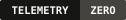](#hosted-account-and-opt-in-cloud-sync)
[](#development-and-testing)
[](LICENSE)

[**Download `lm-subs-v0.2.8.zip`**](docs/releases/lm-subs-v0.2.8.zip) | [**Interactive Two-Way Setup (`lm-subs.vercel.app/welcome`)**](https://lm-subs.vercel.app/welcome) | [**Neon vs Supabase & Firebase Guide (`DEPLOYMENT_GUIDE.md`)**](DEPLOYMENT_GUIDE.md) | [**About (`@sarang-cmd`)**](#about-the-creator)

<br />

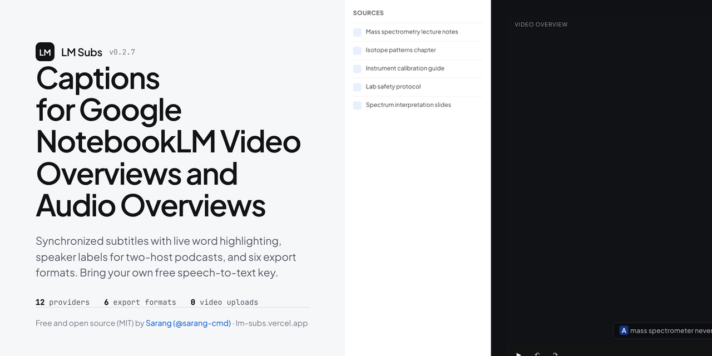

</div>

---

## Install guide (no coding or credit card needed)

You do not need terminal commands, developer tools, or a paid subscription to use LM Subs. Clicking download on [`lm-subs.vercel.app`](https://lm-subs.vercel.app) automatically opens an interactive two-way setup wizard, and installing the extension opens `/welcome` automatically in **Google Chrome**, **Brave**, **Microsoft Edge**, or **Arc**:

### Step 1: Download and unzip the extension folder
1. Download [**`lm-subs-v0.2.8.zip`**](docs/releases/lm-subs-v0.2.8.zip) to your computer.
2. **Unzip** it into a normal folder:
   * **macOS:** Open **Downloads** in Finder and double-click `lm-subs-v0.2.8.zip`. Move the unzipped folder into **Documents** so it stays in a permanent spot.
   * **Windows:** Open **Downloads** in File Explorer, right-click `lm-subs-v0.2.8.zip`, click **Extract All...**, and click **Extract**. Keep the unzipped folder somewhere permanent such as **Documents**.

### Step 2: Load in Chrome and pin from `Access requested`
1. Open a new browser tab, type `chrome://extensions` into the address bar, and press **Enter** (`brave://extensions` in Brave, `edge://extensions` in Edge).
2. Turn **ON** the **Developer mode** switch in the top-right corner of the page.
3. Click the **Load unpacked** button in the top-left corner and select the unzipped `lm-subs` folder from Step 1.
4. Chrome automatically opens the **LM Subs Welcome** page (`/welcome`). Click the puzzle-piece Extensions icon in the top-right Chrome toolbar: **LM Subs** appears at the top under **Access requested** (*"To give an extension access to this site, click it."*) so you can pin and verify it right away without scrolling through other extensions.

### Step 3: Save one free Groq transcription key (60 seconds)
LM Subs connects directly from your browser to a speech-to-text provider so nobody charges you a subscription fee. **Groq** offers a free developer account with no credit card that transcribes up to 8 hours of audio per day:
1. Open [console.groq.com/keys](https://console.groq.com/keys) and sign in with Google or GitHub.
2. Click **Create API Key**, enter `LM Subs` as the name, and copy the key starting with `gsk_`.
3. Paste that `gsk_...` key directly on the `/welcome` setup page (or inside the **LM Subs** toolbar popup) and click **Save**.

### Step 4: Play any NotebookLM Video or Audio Overview
1. Open [notebooklm.google.com](https://notebooklm.google.com), open any notebook, and play either a **Video Overview** or a two-host **Audio Overview** podcast.
2. Within about three seconds, synchronized captions with active-word highlighting appear inside the video frame (or in the compact bottom podcast dock for Audio Overviews), accompanied by an optional completion chime.
3. Use the compact **CC**, **Transcript**, and **Options** controls docked inside the bottom bar to toggle captions (`C`), open the click-to-seek **Transcript** drawer (`T`), adjust word-for-word highlight delay (`{` / `}` or the Style slider), switch caption backdrop (`B`), resize text (**A-** / **A+**), shift cue timing (`[` / `]`), view keyboard shortcuts (`?`), or export **`.srt`**, **`.vtt`**, **`.txt`**, **`.md`**, **`.csv`**, or **`.json`** files.

---

## Product tour and screenshots

### Compact bottom play-bar controls and highlighted spoken-word captions inside NotebookLM
Synchronized closed captions with 3-state progressive word highlighting, adjustable word-highlight delay (`-500 ms` to `+1500 ms`), compact **CC** and **Transcript** controls integrated directly into the bottom play bar, and a secondary tools popover for styling, study loops, and `.srt`/`.vtt`/`.txt`/`.md`/`.csv`/`.json` export.

<p align="center">
  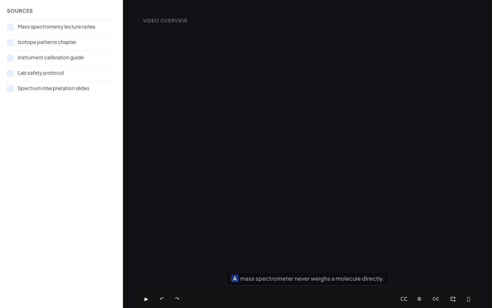
</p>

### The page that opens the moment you install the extension
Downloading LM Subs on the website or installing the extension in Chrome opens `/welcome` automatically. Because LM Subs uses `activeTab` without pre-granting host permissions on the setup website, Chrome places **LM Subs** at the top of the puzzle-piece Extensions menu under **Access requested** (*"To give an extension access to this site, click it."*) above your other extensions, then verifies pinning, API keys, and cloud sync live across a two-way bridge.

<p align="center">
  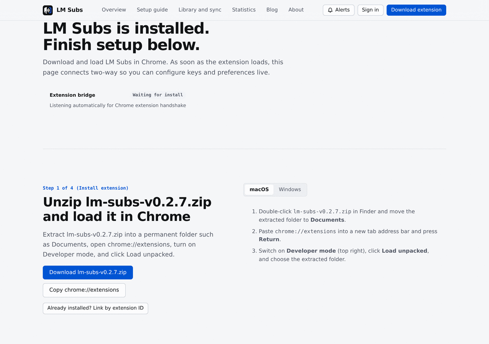
</p>

### Chrome toolbar popup
Configure a free Groq or Mistral key, inspect account sync state, trigger captions on active NotebookLM Video Overviews and Audio Overviews, or export `.srt`, `.vtt`, `.txt`, `.md`, `.csv`, and `.json` files from the toolbar.

<p align="center">
  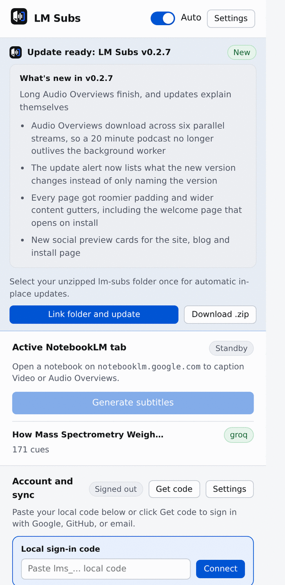
</p>

### Caption studio, word-highlight delay, and Audio Overview controls
Adjust progressive word-highlight delay (`-500 ms` to `+1500 ms`), toggle speaker labels, customize caption backdrop opacity, and control automatic transcription across both Studio Video Overviews and two-host Audio Overviews. Fine grained controls (speed, loop, Picture in Picture, snapshot, volume boost, skip silence) stay behind a single switch so the play bar keeps its default two buttons.

<p align="center">
  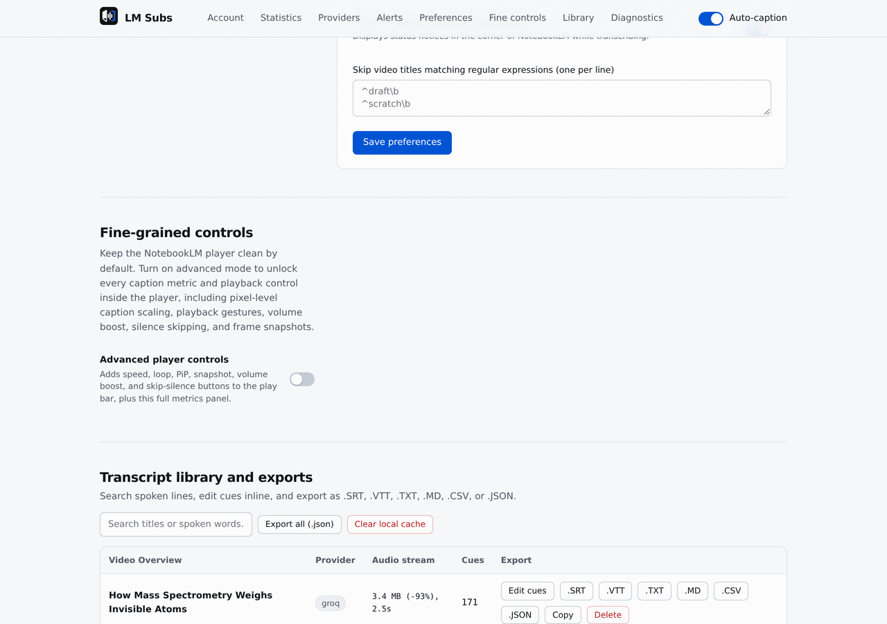
</p>

### Unified statistics on the website, in the settings page, and in the popup
One report feeds all three surfaces: caption totals, bytes of video avoided, provider share, a 14 day series, and Google NotebookLM workspace metrics that go beyond captions (sources, Studio artifacts, watch and listen time, bookmarks, citations, exports).

<p align="center">
  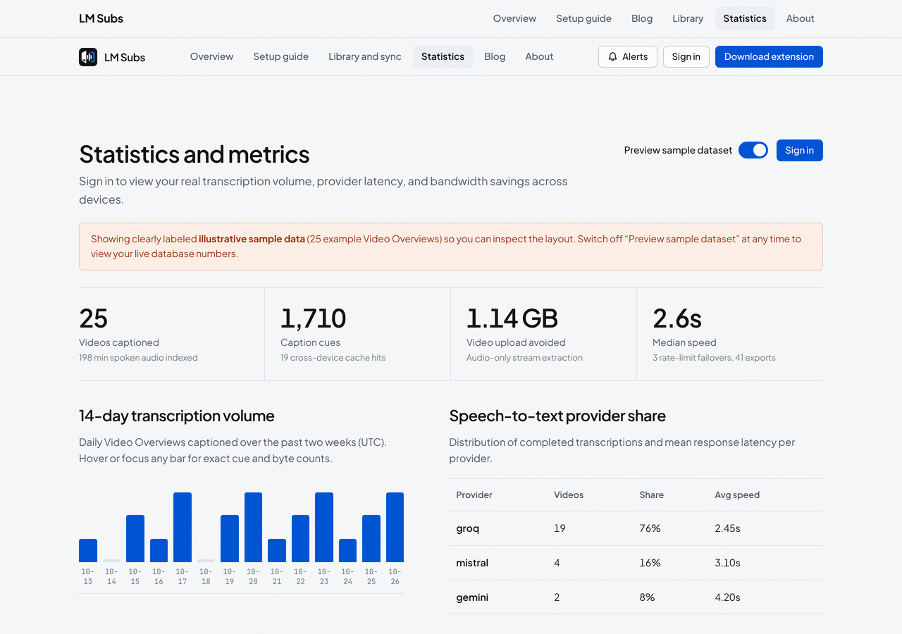
</p>

### Docked fine grained controls in the native play bar
Turning on the fine controls switch docks speed, loop, Picture in Picture with captions, snapshot export, volume boost, and skip silence next to **CC** and **Options** inside NotebookLM's own bottom bar. They appear and fade with NotebookLM's controls, and captions scale with the player so the compact Studio view and fullscreen each look right.

<p align="center">
  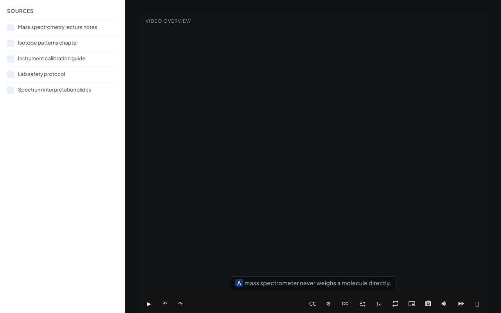
</p>

### Numbered API key walkthroughs for every provider
All twelve providers include account requirements, a key format hint, and a numbered walkthrough that starts at signing in or creating the account.

<p align="center">
  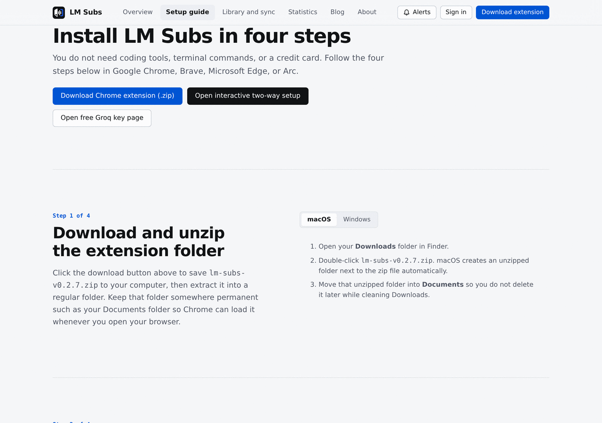
</p>

---

## Guides on the blog

Nine crawlable guides live at [lm-subs.vercel.app/blog](https://lm-subs.vercel.app/blog). Each one is plain HTML with an on page index, a reading time, next and previous links, and Article, FAQ, and breadcrumb structured data.

<p align="center">
  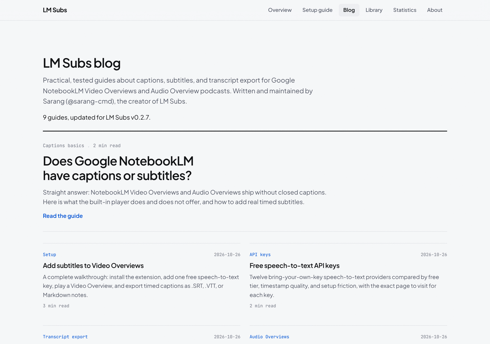
</p>

| Guide | What it answers |
| :--- | :--- |
| [Does NotebookLM have captions?](https://lm-subs.vercel.app/blog/does-notebooklm-have-captions) | What the built-in player does and does not offer |
| [Add subtitles to Video Overviews](https://lm-subs.vercel.app/blog/notebooklm-video-overview-subtitles) | Install, add a key, and export step by step |
| [Free speech-to-text API keys](https://lm-subs.vercel.app/blog/free-speech-to-text-api-keys) | Where to get a key for each of the twelve providers |
| [Export transcripts as SRT and VTT](https://lm-subs.vercel.app/blog/export-notebooklm-transcript-srt-vtt) | Every export format and when to use it |
| [Caption Audio Overview podcasts](https://lm-subs.vercel.app/blog/notebooklm-audio-overview-podcast-captions) | Two host podcasts with speaker labels |
| [SRT, VTT, or Markdown?](https://lm-subs.vercel.app/blog/notebooklm-transcript-srt-vs-vtt-vs-markdown) | Picking the right caption format |
| [Run Whisper locally](https://lm-subs.vercel.app/blog/run-whisper-locally-notebooklm-captions) | Caption offline with no key and no upload |
| [What captions really cost](https://lm-subs.vercel.app/blog/speech-to-text-cost-notebooklm-free-tiers) | Free tier math and when paying makes sense |
| [Captions and WCAG](https://lm-subs.vercel.app/blog/notebooklm-captions-accessibility-wcag) | What the accessibility standard requires |

---

## Why LM Subs?

Google NotebookLM generates narrated **Studio Video Overviews** and two-host **Audio Overviews**, yet its built-in players ship without synchronized word-level closed captions, downloadable multi-format subtitle files, or cross-browser transcript sync.

Naive transcription tools upload entire 50 to 120 MB HD `.mp4` video files or inflate compressed audio into 40+ MB of uncompressed `.wav` data, hitting API upload limits and turning a 3-minute Video Overview into a multi-minute wait.

| Metric | Full Video / WAV Upload | LM Subs (`v0.2.8`) |
| :--- | :--- | :--- |
| **Media payload** | 50 to 120 MB `.mp4` + 42 MB `.wav` | **~3.4 MB `=m140` AAC** (or HTTP `206` audio byte ranges) |
| **Audio prep overhead** | 45 to 90s full download + decode | **0 ms** direct `=m140` passthrough (`<1.2s` Range remux) |
| **Whisper timestamp mode** | Slow word-level DTW alignment | **Segment timestamps (~200x real-time)** + clause balancer |
| **Long-video chunking** | Sequential 1-by-1 upload | **3x concurrent workers + live progressive cues** |
| **Second-browser open** | Re-downloads and re-transcribes | **~50 ms Neon Postgres cache hit** (`0` media bytes fetched) |

---

## How LM Subs delivers captions in seconds

1. **Zero-decode `=m140` audio stream passthrough (`0 ms` IPC):** Google's FIFE `=m140` stream serves a ~3 to 6 MB `audio/mp4` payload. `service-worker.js` inspects `inspectMp4Tracks()` and `Content-Type` and forwards pure-audio payloads (`<=24 MB`) directly to your speech-to-text provider without inflating them into PCM `.wav`.
2. **Parallel `HTTP 206 Partial Content` audio byte-range extraction:** When a CDN edge serves a muxed 50 to 120 MB `=m22` `video/mp4`, LM Subs aborts the full download after reading headers, probes the `moov` atom via `Range: bytes=...`, and fetches only the 3 to 6 MB `soun` audio slices over 6 parallel `HTTP 206` requests.
3. **Segment-level Whisper timestamps (~200x real-time):** Requesting segment timestamps instead of word-level DTW alignment and balancing two-line cues client-side via `cuesFromSegments()` cuts transcription latency by 4 to 8x.
4. **Concurrent chunk workers + progressive cues (`SUBTITLES_PARTIAL`):** Long recordings (`>24 MB`) transcribe 3 audio chunks concurrently and render live cues on the `<video>` element as soon as chunk 1 completes.
5. **Pre-download Neon Postgres cache hit (~50 ms):** Before downloading media from Google's CDN, `service-worker.js` checks local storage and `GET /api/sync/subtitle?cacheKey=...` so previously captioned videos load instantaneously across your signed-in browsers.

---

## System architecture

<p align="center">
  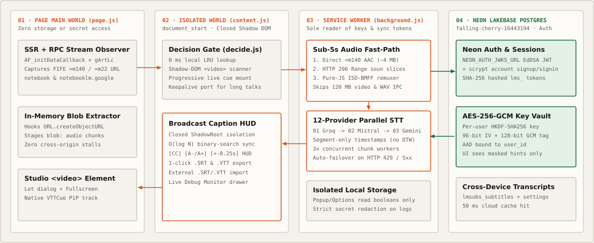
</p>

* **Page Main World (`src/content/page-hook.js` at `document_start`):** Observes NotebookLM SSR `AF_initDataCallback` payloads and `batchexecute` RPCs (`R7cb6c`, `gArtLc`) without touching storage or credentials.
* **Isolated Content Script (`src/content/content.js` + `player-overlay.js`):** Attaches both a native `<track kind="subtitles">` (for OS Picture-in-Picture) and an isolated closed ShadowRoot caption bar inside NotebookLM's `<video>` container.
* **MV3 Service Worker (`src/background/service-worker.js`):** Sole reader of `secretApiKeys` and `cloudSyncSecret` in `chrome.storage.local`. Executes audio stream extraction, 12-provider failover, and opt-in cloud sync.
* **Hosted Web App & Neon Postgres API (`src/web/`, `server/`, `api/index.js`):** React + Radix UI web application (`/`, `/guide`, `/library`, `/stats`, `/about`) and Hono REST API backed by Neon Serverless PostgreSQL (`db/schema.sql`). Includes Vercel Web Analytics and Vercel Speed Insights.

---

## Hosted account and opt-in cloud sync

End users never self-host a database or configure a server URL. Sign in from the extension or web app using **Google**, **GitHub**, or a **passwordless 6-digit email code**:

* **Granular opt-in switches:** Control three independent switches in both the web library and extension settings:
  1. **Sync API keys** (`AES-256-GCM` per-user HKDF-derived encryption bound to `${userId}:${providerId}` as AAD).
  2. **Sync transcriptions** (searchable caption archive with `.srt`, `.vtt`, `.txt`, and `.json` downloads).
  3. **Sync preferences** (provider priority order, caption font scale, and target language).
* **One-click cloud purge:** Turning off any switch can immediately delete your stored cloud rows for that category in Neon Postgres while keeping your local Chrome data untouched.
* **Live SQL statistics (`/stats`):** Displays real `COUNT`, `SUM`, `AVG`, 14-day daily transcription volume, upload bandwidth saved, and per-provider latency queried directly from `lmsubs_subtitles` and `lmsubs_transcription_events`.

### Deploying your own fork (Neon correlated with Supabase & Firebase)

Read [**`DEPLOYMENT_GUIDE.md`**](DEPLOYMENT_GUIDE.md) for:
* A first-principles guide correlating **Neon** with **Supabase** and **Firebase** (SQL Editor migrations, why no storage buckets are needed, why Firebase auto-configures Google OAuth while Supabase and Vercel + Neon use Google Cloud Console OAuth credentials, and server-vault encryption vs client RLS).
* Exact step-by-step instructions to connect Neon (`falling-cherry-16443194`), Google OAuth, GitHub OAuth, and Resend on Vercel.

---

## Supported speech-to-text providers

Configure one key or stack multiple providers in priority order for automatic `HTTP 429` rate-limit failover:

| Rank | Provider | Default model | Free tier and billing notes |
| :-: | :--- | :--- | :--- |
| **1** | **Groq** *(Recommended)* | `whisper-large-v3-turbo` | Free developer tier (~8 hrs/day, no credit card) |
| **2** | **Mistral AI** *(Recommended)* | `voxtral-mini-latest` | Free La Plateforme tier, 48 MB file cap |
| **3** | **Google Gemini** | `gemini-2.5-flash` | Free Google AI Studio tier, native translation |
| **4** | **Deepgram** | `nova-3` | $200 free starter credit |
| **5** | **AssemblyAI** | `universal` | $50 free starter credit |
| **6** | **Gladia** | `solaria-1` | 10 free hours per month |
| **7** | **Cloudflare Workers AI** | `@cf/openai/whisper-large-v3-turbo` | 10,000 free neurons per day |
| **8** | **ElevenLabs** | `scribe_v1` | Free starter quota, 99 languages |
| **9** | **Hugging Face** | `openai/whisper-large-v3-turbo` | Free monthly inference credits |
| **10** | **OpenRouter** | `google/gemini-2.5-flash` | Unified multi-model router |
| **11** | **OpenAI** | `whisper-1` | Pay-as-you-go (`$0.006/min`) |
| **12** | **Local / Custom** | `Systran/faster-whisper-small` | 100% free and offline (`faster-whisper-server` / `whisper.cpp`) |

---

## Security and privacy architecture

* **Minimal Manifest V3 permissions:** Requests only `"storage"` in `extension/manifest.json`, plus narrow host permissions for NotebookLM and Google media CDNs.
* **Service-worker secret isolation:** Automated static-analysis tests (`tests/e2e.test.js`) verify that `content.js`, `page.js`, `popup.js`, and `options.js` never import secret-storage getters.
* **Diagnostic redaction:** `GET_DEBUG_REPORT` scrubs `Bearer` headers, `lms_...` session tokens, `gsk_...`/`sk-...`/`AIza...` keys, and signed FIFE query parameters.

---

## Development and testing

```bash
npm install          # Install dependencies (0 vulnerabilities)
npm run assets       # Render SVG/PNG brand marks, favicons, badges, diagram, and 4 screenshots
npm run build        # Bundle all 5 MV3 extension entrypoints + React web app (docs/app.js)
npm run zip          # Rebuild bundles and package docs/releases/lm-subs-v0.2.8.zip
npm test             # Run unit, security, speed, export, and PGlite Postgres E2E tests
npm start            # Start unified Web App + /api/* Hono server on http://0.0.0.0:4173
```

---

## About the creator

Created by **Sarang** ([`@sarang-cmd`](https://github.com/sarang-cmd)), a computer science student and agentic engineer based in Germany.

---

## License

Released under the [MIT License](LICENSE). Independent open-source project, unaffiliated with Google LLC.
